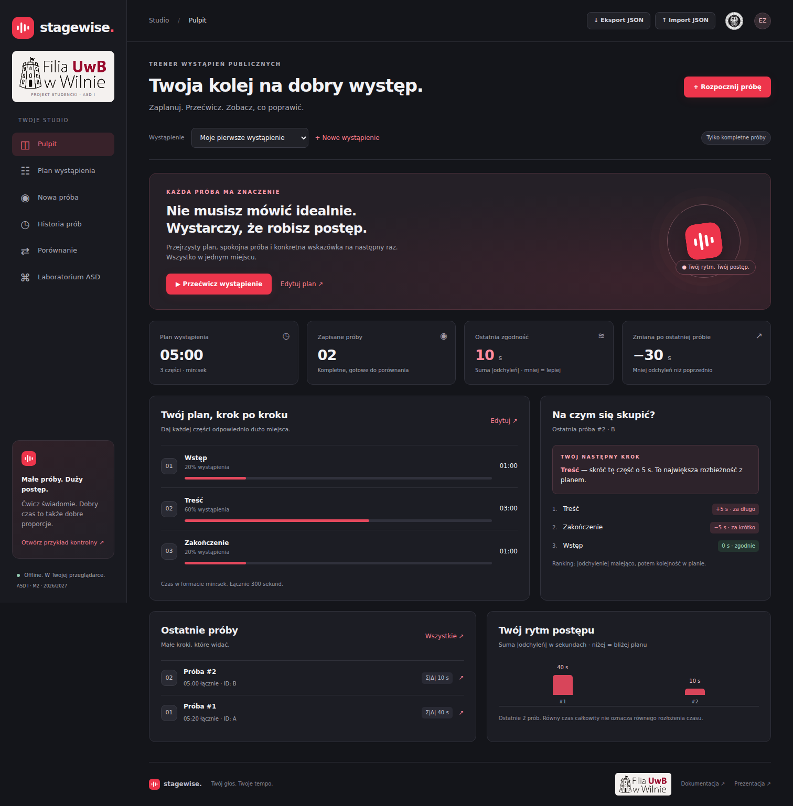

# Stagewise — Trener wystąpień publicznych

**ASD1-M2-13 · Mini-projekt M2 · Algorytmy i struktury danych I · 2026/2027**
Autor / student: **Edvin Zenevič**. Opracowanie z pomocą AI — szczegóły poniżej.



## Uruchomienie — bez instalacji

1. Pobierz i rozpakuj cały projekt.
2. Otwórz **`index.html`** w aktualnej przeglądarce.
3. Gotowy przykład zawiera plan `[60,180,60]` i próby A/B. Możesz edytować próby, tworzyć własne wystąpienia oraz importować JSON.

**Aplikacja nie wymaga internetu, konta, serwera, API ani procesu budowania.** Skrypty i zasoby są lokalne. Opcjonalny serwer: `python3 -m http.server 8000 --bind 127.0.0.1`.

## Funkcje

- Wiele wystąpień; nazwy, identyfikatory, uporządkowane części i planowany czas.
- Stoper start/stop/wznowienie/reset dla wybranej części oraz ręczny wpis sekund.
- Kompletne próby z numerami i notatkami; edycja czasów bez zmiany ID.
- Różnice dla każdej części i całości, ranking odchyleń oraz porównanie dwóch prób.
- Jasny remis zamiast arbitralnego zwycięzcy.
- Własne wyszukiwanie liniowe po ID i sortowanie przez wstawianie.
- Rzeczywiste liczniki operacji, tabela „przed → decyzja → po”, powtarzalne doświadczenia.
- Import/eksport JSON z wersją formatu; walidacja całego pliku przed potwierdzeniem zastąpienia.
- Pomocniczy zapis localStorage oraz dodatkowy wykres zmian zgodności.
- Responsywny ciemny interfejs z czerwonymi akcentami, etykietami, obsługą klawiatury i lokalnym logo Stagewise.

## Jak używać

1. **Plan wystąpienia:** dodaj części, nazwy i czasy, ustaw kolejność, zapisz.
2. **Nowa próba:** mierz jedną część stoperem; **Stop** wpisuje jej sekundy do formularza. Możesz poprawić wynik albo wpisać wszystkie czasy ręcznie.
3. Uzupełnij każdą część (również `0`, jeśli została pominięta), dodaj notatkę i wybierz **Zapisz kompletną próbę**. Sam Stop nie zapisuje całej próby.
4. **Historia prób:** pełna karta, wyszukiwanie po ID, edycja.
5. **Porównanie:** wybierz dowolne dwie zapisane próby tego samego wystąpienia.
6. **Laboratorium ASD:** wyszukuj ID, obejrzyj realny ślad sortowania i liczniki; przyciski wczytują trzy scenariusze po potwierdzeniu.
7. **Eksport JSON** zachowuje zapisany zestaw. Roboczy formularz nie jest częścią eksportu.

## Reguły i model

Zestaw: `{ format: "stagewise", version: 1, speeches: [], parts: [], trials: [] }`.

| Rekord | Pola |
|---|---|
| Wystąpienie | `id`, `title` |
| Część | `id`, `speechId`, `order`, `name`, `plannedSeconds` |
| Próba | `id`, `speechId`, `number`, `actualSeconds` (obiekt ID części → sekundy), `note` |

- Do **1000 rekordów każdego rodzaju** w całym zestawie. ID są globalnie unikalne, niepuste, niezmienne; import przyjmuje 1–80 znaków `A–Z`, cyfr i `-`.
- Czasy: całkowity plan **1–3600 s**, wykonanie **0–7200 s**. Pusty wpis nie oznacza zera.
- Próba ma dokładnie jeden czas dla każdej części; brakujące lub nadmiarowe pola czasu są odrzucane.
- Kolejność części to `1…n`. Numer nowej próby to największy zapisany plus jeden.
- Tytuł 1–160 znaków, nazwa części 1–100, notatka do 4000 znaków.
- Każda transakcja najpierw sprawdza pełny kandydat. Błąd nie pozostawia częściowego zapisu.
- Zmiana części planu z historią wymaga potwierdzonego usunięcia jego prób. Alternatywa: nowe wystąpienie. Sama zmiana tytułu zachowuje próby.
- Import: cały plik jest parsowany i walidowany **przed** pytaniem o zastąpienie. Anulowanie lub błędny plik zachowuje pracę.
- Tekst użytkownika jest kodowany w widokach; wpisany HTML nie jest wykonywany.

## Własne algorytmy

W `app/algorithms.js`:

- `summarizeTrial`: liniowo oblicza różnice, sumy i sumę modułów, O(p) dla p części.
- `findTrialById`: własna pętla, pierwsze dopasowanie ID; licznik rzeczywiście sprawdzonych rekordów. O(t), dodatkowa pamięć O(1) dla t prób.
- `insertionSort`: własne sortowanie; licznik rzeczywistych wywołań porównania kluczy. Klucz: `|odchylenie|` malejąco, następnie `order` rosnąco. O(p) dla uporządkowanych, O(p²) w najgorszym przypadku; kopia wyniku O(p).
- `analyzeTrial`: podsumowanie i ranking. Ślad jest emitowany przez rzeczywisty algorytm. Kopie stanów to osobny narzut edukacyjny; UI pokazuje ślad do 12 części, ranking liczy także dla 1000.
- `compareTrials`: porównanie według sumy modułów; remis zwraca `winnerId: null`.

W głównej ścieżce nie ma `Array.sort`. Używamy go wyłącznie jako niezależnego wzorca w testach i benchmarku. Widoki historii korzystają z liniowego podsumowania, nie sortują zbędnie każdej próby.

### Kontrolny wynik

| Część | Plan | A | Δ A | B | Δ B |
|---|---:|---:|---:|---:|---:|
| Wstęp | 60 | 70 | +10 | 60 | 0 |
| Treść | 180 | 200 | +20 | 185 | +5 |
| Zakończenie | 60 | 50 | −10 | 55 | −5 |
| Razem | **300** | **320** | **+20** | **300** | **0** |

A: Σ|Δ| = **40 s**, ranking **treść → wstęp → zakończenie**. B: Σ|Δ| = **10 s**. **B jest bliższa planowi o 30 s**.

Dlaczego +20 s i −20 s nie powinny się ukrywać? Ich suma to zero, ale suma modułów to 40 s: wystąpienie ma poprawny czas całkowity, lecz złe proporcje.

## Testy — jedno polecenie

Wymagany Node.js, bez instalowania pakietów:

```bash
node tests/run.cjs
```

Równoważnie: `npm test`. Faktyczny wynik przygotowania: **36/36 PASS**. Każdy przypadek ma jawne wejście, oczekiwanie i asercję. Pełne wyniki: [`results/tests.json`](results/tests.json), [`results/tests.txt`](results/tests.txt).

Kontrole interfejsu wymagają narzędzi deweloperskich:

```bash
npm ci
npx playwright install chromium
npm run test:browser
```

Faktycznie wykonano **23/23 PASS**: `file://` przy zablokowanej sieci; rzeczywisty stoper; kompletność; zapis i edycja; import poprawny, błędny i anulowany; eksport; zmiana planu; kolejność; Enter; HTML jako tekst; puste widoki; powrót do zapisu; szerokości 390/768 px; 1000 części i 1000 prób. Dowód: [`results/browser.json`](results/browser.json). Brak błędów JS i żądań HTTP/HTTPS.

Narzędzia wspierają `PLAYWRIGHT_MODULE`, `PDF_LIB_MODULE` oraz `CHROMIUM_PATH`. Chromium wymaga standardowych bibliotek systemowych; narzędzia nie są zależnością działającej aplikacji.

## Powtarzalny benchmark

```bash
node tools/benchmark.cjs
```

| Rekordy | Uporządkowane | Odwrócone | Pseudolosowe |
|---:|---:|---:|---:|
| 10 | 9 | 45 | 26 |
| 100 | 99 | 4950 | 2505 |
| 1000 | 999 | 499500 | 252410 |

Wszystkie **9/9** wyników zgodne z niezależnym wzorcem. Dane: LCG, ziarno 13013; parametry i faktyczne wyniki w [`results/benchmark.json`](results/benchmark.json). Dla uporządkowanych wystarcza n−1 porównań, a dla odwróconych potrzeba n(n−1)/2 przesunięć i porównań. Licznik nie obejmuje sprawdzeń indeksu.

Wyszukiwanie dla 10/100/1000 prób: początek **1**, koniec **n**, brak **n**. Licznik zwiększa się w faktycznej pętli, a funkcja zwraca pierwsze dopasowanie.

## Dane demonstracyjne

- [`data/control.json`](data/control.json): kontrolny plan oraz A/B.
- [`data/boundary.json`](data/boundary.json): plan 1/3600/60 s; wykonanie 0/7200/60 i próba idealna.
- [`data/large.json`](data/large.json): **1000 części i 1000 kompletnych prób**, powtarzalne dane; większy plik jest celowy.

Import ma limit 32 MB. Duży zestaw może przekroczyć limit localStorage — program wyraźnie o tym informuje, zachowuje poprawne dane w pamięci i pozwala eksportować JSON. Nie traktujemy błędu pomocniczego zapisu jako odrzucenia poprawnej transakcji.

## Architektura

```text
index.html + app/styles.css
  app/ui.js           zdarzenia, potwierdzenia, sterowanie
  app/views.js        bezpieczne widoki i wyniki
  app/model.js        walidacja, atomowe transakcje, import/eksport
  app/algorithms.js   obliczenia, wyszukiwanie, sortowanie, ślad
  app/timer.js        monotoniczny stoper, pełne sekundy
  app/storage.js      localStorage i pobieranie JSON
  app/scenarios.js    trzy zestawy danych
  app/benchmarks.js   wyniki wygenerowane przez narzędzie
tests/                testy domenowe i przeglądarkowe
tools/                benchmark, generator i kontrola dokumentów
```

## Materiały do oddania

- Cała aplikacja, źródła, dane i testy — ten projekt / archiwum ZIP.
- [`docs/documentation.pdf`](docs/documentation.pdf) — **dokładnie 10 stron po polsku**, łącznie z tytułową.
- [`presentation/presentation.pdf`](presentation/presentation.pdf) — **dokładnie 10 slajdów**.
- [`presentation/presentation.html`](presentation/presentation.html) — osobna prezentacja lokalna: strzałki, Spacja, Home/End, przyciski i pełny ekran.
- Edytowalne źródła HTML obu dokumentów.
- [`presentation/speaker-notes.md`](presentation/speaker-notes.md) — wyjaśnienia każdego slajdu.
- [`DEFENSE.md`](DEFENSE.md) — scenariusz demonstracji i ćwiczenia przed obroną.
- [`SUBMISSION.md`](SUBMISSION.md) — mapa wymagań, link i czynności związane z Dziennikiem.

Dokumenty generowane są z rzeczywistych wyników JSON i własnych zrzutów. Po testach przeglądarkowych:

```bash
python3 tools/build_docs.py
node tools/export_pdf.cjs
```

Eksport sprawdza rozmiary treści względem stopki i brak przepełnień, a potem niezależnie liczy strony przez pdf-lib. Wynik: [`results/documents.json`](results/documents.json).

## GitHub i wersja

Repozytorium: **https://github.com/EdvinZe/asd1-m2-13-stagewise**.
Oznaczenie wersji oddania: **`m2-v1.0.0`** — tag wskazujący konkretny commit.

```bash
git rev-parse 'm2-v1.0.0^{commit}'
```

Pełny SHA jest również podany w wiadomości z gotowym projektem i pliku `ODDANIE.txt` obok folderu w archiwum. Repozytorium ma zawierać tę samą wersję kodu, danych, testów, README i dokumentów. **Sam link nie zastępuje plików.** Link repozytorium należy osobno wpisać w polu „Linki” przy oddawaniu M2. Jeśli repozytorium pozostaje prywatne, prowadzący musi mieć przyznany dostęp. Nie wysłano zgłoszenia do Dziennika.

## Ograniczenia

- Brak analizy treści, rozpoznawania mowy, synchronizacji i kont; nie są wymagane.
- localStorage jest dodatkiem zależnym od przeglądarki, szczególnie przy `file://`. **Eksportuj JSON przed zamknięciem.**
- Robocze formularze nie są zapisywane po zamknięciu. Strona ostrzega przed opuszczeniem z niezapisanymi zmianami.
- Stoper bazuje na `performance.now()` i zaokrągla w dół do całkowitych sekund. Uśpienie systemu może być obsługiwane różnie przez przeglądarki; długie pomiary należy sprawdzić ręcznie.
- Dokumenty i prezentację sprawdzono w Chromium. PDF jest gotowym, niezależnym formatem do oddania.

## Źródła i uczciwe opisanie AI

- Karta ASD1-M2-13 z Dziennika UwB: kopia [`docs/assignment.html`](docs/assignment.html) — wymagania i przykład.
- [MDN — Performance.now()](https://developer.mozilla.org/en-US/docs/Web/API/Performance/now) — pomiar czasu.
- [MDN — Window.localStorage](https://developer.mozilla.org/en-US/docs/Web/API/Window/localStorage) — zapis i ograniczenia `file://`.
- [GitHub Docs — Quickstart for repositories](https://docs.github.com/en/repositories/creating-and-managing-repositories/quickstart-for-repositories) — repozytorium i commit.

Logotyp Filia UwB w Wilnie i herb Uniwersytetu w Białymstoku pochodzą z plików dostarczonych przez zlecającego; zachowano oryginalne obrazy. Służą oznaczeniu kontekstu projektu studenckiego, nie deklarują oficjalnego produktu uczelni. Znak aplikacji Stagewise jest osobnym, lokalnym zasobem SVG.

Źródła internetowe sprawdzono 19.11.2026. Algorytmy zaimplementowano dla tego projektu, bez biblioteki sortującej w produkcie.

**Wsparcie AI:** OpenAI Codex w OpenClaw przygotował implementację, warstwę wizualną, testy, wyniki pomiarów i dokumenty. Asystent wykonał automatyczne kontrole. Zlecający wybrał temat i kierunek kolorystyczny. Nie przypisujemy studentowi niepotwierdzonych własnych zmian ani wykonania testów. Przed oddaniem student powinien sam uruchomić aplikację/testy, zrozumieć kod i przećwiczyć modyfikację na żywo; rzeczywiste własne zmiany należy opisać zgodnie z faktami.
